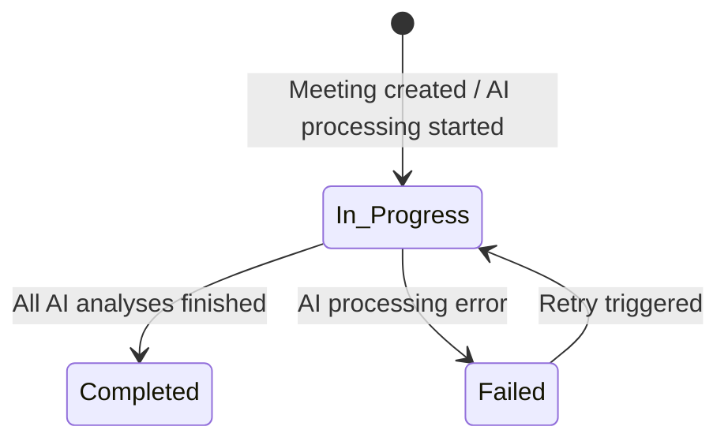

# Data Model: Migration vers PostgreSQL

**Feature**: 003-postgres-migration | **Date**: 2026-04-01

## Entity Relationship Diagram

```mermaid
erDiagram
    USER ||--o{ MEETING : "owns (createdBy)"
    MEETING ||--o{ TRANSCRIPT_SEGMENT : "has"
    MEETING ||--o| SUMMARY : "has"
    MEETING ||--o{ ANALYTIC_DATA : "has"

    USER {
        uuid id PK
        string email UK
        string password
        string firstName
        string lastName
        json roles
        boolean isActive
        datetime createdAt
        datetime updatedAt
        datetime deletedAt "nullable"
    }

    MEETING {
        uuid id PK
        uuid createdBy FK "→ USER.id"
        string title "NOT NULL, max 255"
        string category "nullable, max 50"
        datetime startAt "NOT NULL"
        int durationMinutes "NOT NULL"
        string status "ENUM: In_Progress, Completed, Failed"
        json participants "array of {name, role}"
        string description "nullable, TEXT"
        boolean starred "default false"
        datetime createdAt
        datetime updatedAt
        datetime deletedAt "nullable, soft-delete"
    }

    TRANSCRIPT_SEGMENT {
        uuid id PK
        uuid meetingId FK "→ MEETING.id, ON DELETE CASCADE"
        string speaker "NOT NULL, max 100"
        string speakerColor "nullable, max 7 (hex)"
        string timeStart "NOT NULL, format HH:MM:SS"
        string timeEnd "NOT NULL, format HH:MM:SS"
        text content "NOT NULL"
        int orderIndex "for display ordering"
        datetime createdAt
    }

    SUMMARY {
        uuid id PK
        uuid meetingId FK "→ MEETING.id, UNIQUE, ON DELETE CASCADE"
        string title "NOT NULL, max 255"
        string type "ENUM: PV, Synthese"
        json content "JSONB: {executiveOverview, keyDecisions[], nextSteps[]}"
        json focusAreas "JSONB: {keyDecisions, discussions, actionItems}"
        string detailLevel "ENUM: short, medium, detailed"
        int version "default 1"
        datetime createdAt
        datetime updatedAt
    }

    ANALYTIC_DATA {
        uuid id PK
        uuid meetingId FK "→ MEETING.id, ON DELETE CASCADE"
        string metricKey "NOT NULL, max 100"
        json metricValue "JSONB: flexible value"
        datetime createdAt
    }
```

## Entity Details

### Meeting

| Field | Type | Constraints | Notes |
|-------|------|-------------|-------|
| `id` | UUID | PK, auto-gen | Doctrine UUID generator |
| `createdBy` | UUID | FK → User, NOT NULL | Owner of the meeting |
| `title` | VARCHAR(255) | NOT NULL | |
| `category` | VARCHAR(50) | nullable | e.g. "PRODUCT DEV", "SALES" |
| `startAt` | DATETIME_IMMUTABLE | NOT NULL | When meeting started |
| `durationMinutes` | INTEGER | NOT NULL | Duration in minutes |
| `status` | VARCHAR(20) | NOT NULL | `In_Progress`, `Completed`, `Failed` |
| `participants` | JSON | nullable | Array of `{name, role, initials, color}` |
| `description` | TEXT | nullable | Short summary text |
| `starred` | BOOLEAN | default false | User bookmark |
| `createdAt` | DATETIME_IMMUTABLE | NOT NULL, auto | |
| `updatedAt` | DATETIME_IMMUTABLE | NOT NULL, auto | |
| `deletedAt` | DATETIME_IMMUTABLE | nullable | Soft-delete marker |

**Indexes**: `idx_meeting_created_by`, `idx_meeting_status`, `idx_meeting_deleted_at`

### TranscriptSegment

| Field | Type | Constraints | Notes |
|-------|------|-------------|-------|
| `id` | UUID | PK, auto-gen | |
| `meetingId` | UUID | FK → Meeting, NOT NULL | CASCADE on delete |
| `speaker` | VARCHAR(100) | NOT NULL | Speaker name/label |
| `speakerColor` | VARCHAR(7) | nullable | Hex color code |
| `timeStart` | VARCHAR(12) | NOT NULL | `HH:MM:SS` or `MM:SS` |
| `timeEnd` | VARCHAR(12) | NOT NULL | |
| `content` | TEXT | NOT NULL | Speech content |
| `orderIndex` | INTEGER | NOT NULL | Display order |
| `createdAt` | DATETIME_IMMUTABLE | NOT NULL, auto | |

**Indexes**: `idx_segment_meeting_id`

### Summary

| Field | Type | Constraints | Notes |
|-------|------|-------------|-------|
| `id` | UUID | PK, auto-gen | |
| `meetingId` | UUID | FK → Meeting, UNIQUE, NOT NULL | One summary per meeting |
| `title` | VARCHAR(255) | NOT NULL | |
| `type` | VARCHAR(20) | NOT NULL | `PV` or `Synthese` |
| `content` | JSON (JSONB) | nullable | Structured content object |
| `focusAreas` | JSON (JSONB) | nullable | Boolean flags |
| `detailLevel` | VARCHAR(10) | default `medium` | `short`, `medium`, `detailed` |
| `version` | INTEGER | default 1 | Incremented on update |
| `createdAt` | DATETIME_IMMUTABLE | NOT NULL, auto | |
| `updatedAt` | DATETIME_IMMUTABLE | NOT NULL, auto | |

**Indexes**: `uniq_summary_meeting_id`

### AnalyticData

| Field | Type | Constraints | Notes |
|-------|------|-------------|-------|
| `id` | UUID | PK, auto-gen | |
| `meetingId` | UUID | FK → Meeting, NOT NULL | CASCADE on delete |
| `metricKey` | VARCHAR(100) | NOT NULL | e.g. `summaryMetrics`, `talkTimeData`, `speakers` |
| `metricValue` | JSON (JSONB) | NOT NULL | Flexible JSON payload |
| `createdAt` | DATETIME_IMMUTABLE | NOT NULL, auto | |

**Indexes**: `idx_analytic_meeting_id`, `idx_analytic_key`

## State Transitions

## Validation Rules

- `Meeting.title`: Required, 1-255 chars
- `Meeting.durationMinutes`: Required, positive integer
- `Meeting.status`: Must be one of `In_Progress`, `Completed`, `Failed`
- `TranscriptSegment.content`: Required, non-empty
- `Summary.type`: Must be one of `PV`, `Synthese`
- `Summary.detailLevel`: Must be one of `short`, `medium`, `detailed`
- `AnalyticData.metricKey`: Required, 1-100 chars
