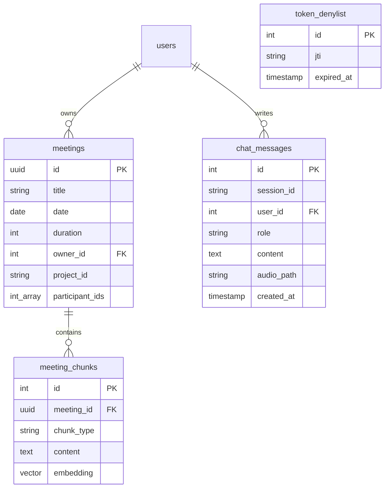

# Data Model Specification

This document details the database schema, security views, relationships, and lifecycle transitions for the local multimodal agent.

---

## 1. Database Schema (PostgreSQL & pgvector)

### Extension
Make sure the `pgvector` extension is enabled in the database:
```sql
CREATE EXTENSION IF NOT EXISTS vector;
```

### Tables

#### 1. `users` (Existing, but referenced)
```sql
CREATE TABLE IF NOT EXISTS users (
    id SERIAL PRIMARY KEY,
    email VARCHAR(255) UNIQUE NOT NULL,
    roles JSONB NOT NULL DEFAULT '["ROLE_USER"]',
    password VARCHAR(255) NOT NULL,
    created_at TIMESTAMP WITH TIME ZONE DEFAULT CURRENT_TIMESTAMP
);
```

#### 2. `meetings` (Existing, but referenced)
```sql
CREATE TABLE IF NOT EXISTS meetings (
    id UUID PRIMARY KEY DEFAULT gen_random_uuid(),
    title VARCHAR(255) NOT NULL,
    date DATE NOT NULL,
    duration INTEGER NOT NULL, -- duration in minutes
    owner_id INTEGER REFERENCES users(id) ON DELETE SET NULL,
    project_id VARCHAR(50) NOT NULL,
    participant_ids INTEGER[] NOT NULL DEFAULT '{}',
    created_at TIMESTAMP WITH TIME ZONE DEFAULT CURRENT_TIMESTAMP
);
```

#### 3. `meeting_chunks`
Holds the semantic chunks with their generated 1024-D vector embeddings (using `qwen3-embedding:0.6b`).
```sql
CREATE TABLE IF NOT EXISTS meeting_chunks (
    id SERIAL PRIMARY KEY,
    meeting_id UUID NOT NULL REFERENCES meetings(id) ON DELETE CASCADE,
    chunk_type VARCHAR(50) NOT NULL, -- 'transcript', 'summary', 'decision', 'action_item', 'behavior'
    content TEXT NOT NULL,
    embedding vector(1024) NOT NULL,
    created_at TIMESTAMP WITH TIME ZONE DEFAULT CURRENT_TIMESTAMP
);

-- Index for fast vector similarity search using Cosine distance
CREATE INDEX IF NOT EXISTS meeting_chunks_embedding_cosine_idx 
ON meeting_chunks USING hnsw (embedding vector_cosine_ops);
```

#### 4. `chat_messages`
Stores the sliding conversation memory (messages are purged automatically in the background if inactive for > 90 days).
```sql
CREATE TABLE IF NOT EXISTS chat_messages (
    id SERIAL PRIMARY KEY,
    session_id VARCHAR(100) NOT NULL,
    user_id INTEGER NOT NULL REFERENCES users(id) ON DELETE CASCADE,
    role VARCHAR(20) NOT NULL, -- 'user', 'assistant'
    content TEXT NOT NULL,
    audio_path VARCHAR(255), -- path to stored audio file if speech-to-text or text-to-speech was used
    created_at TIMESTAMP WITH TIME ZONE DEFAULT CURRENT_TIMESTAMP
);

-- Index for fast session query sorting
CREATE INDEX IF NOT EXISTS chat_messages_session_idx ON chat_messages(session_id, created_at ASC);
```

#### 5. `token_denylist`
Stores revoked JWT identifiers (`jti`) from logout actions.
```sql
CREATE TABLE IF NOT EXISTS token_denylist (
    id SERIAL PRIMARY KEY,
    jti VARCHAR(255) UNIQUE NOT NULL,
    expired_at TIMESTAMP NOT NULL,
    created_at TIMESTAMP WITH TIME ZONE DEFAULT CURRENT_TIMESTAMP
);

-- Index for quick validation checks
CREATE INDEX IF NOT EXISTS token_denylist_jti_idx ON token_denylist(jti);
```

---

## 2. Security Database Views

To protect sensitive user data (like passwords, password hashes, and user tokens) from NL2SQL generators, all LLM SQL queries operate purely on read-only database views that omit these sensitive columns.

#### 1. `view_meetings`
```sql
CREATE OR REPLACE VIEW view_meetings AS
SELECT 
    id AS meeting_id,
    title,
    date,
    duration,
    project_id,
    participant_ids
FROM meetings;
```

#### 2. `view_meeting_analytics`
Allows global analytics of meetings (e.g. counting meetings, decisions, active projects) without revealing vector chunks.
```sql
CREATE OR REPLACE VIEW view_meeting_analytics AS
SELECT 
    m.id AS meeting_id,
    m.title,
    m.date,
    m.project_id,
    COUNT(c.id) FILTER (WHERE c.chunk_type = 'decision') AS total_decisions,
    COUNT(c.id) FILTER (WHERE c.chunk_type = 'action_item') AS total_action_items
FROM meetings m
LEFT JOIN meeting_chunks c ON m.id = c.meeting_id
GROUP BY m.id, m.title, m.date, m.project_id;
```

---

## 3. Entity Relationships



---

## 4. Lifecycle Transitions & Housekeeping

### A. JWT Token Expired-List Clean (Hourly Purge Task)
- **Trigger**: Periodic background job in Flask.
- **Action**: Runs every 1 hour.
- **SQL**:
  ```sql
  DELETE FROM token_denylist WHERE expired_at < CURRENT_TIMESTAMP;
  ```

### B. Chat History Retention (90-Day Sliding Inactivity Purge)
- **Trigger**: Periodic background job or daily trigger.
- **Action**: Deletes chat sessions that have not received any new messages in the last 90 days.
- **SQL**:
  ```sql
  DELETE FROM chat_messages 
  WHERE session_id IN (
      SELECT session_id 
      FROM chat_messages 
      GROUP BY session_id 
      HAVING MAX(created_at) < NOW() - INTERVAL '90 days'
  );
  ```
